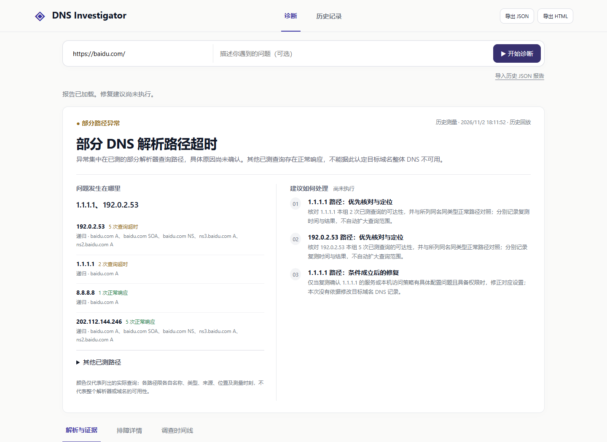
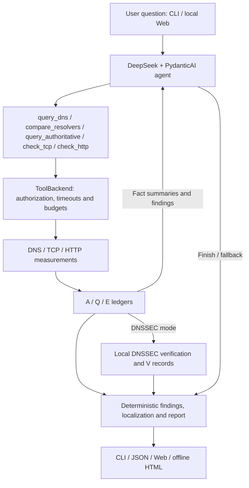
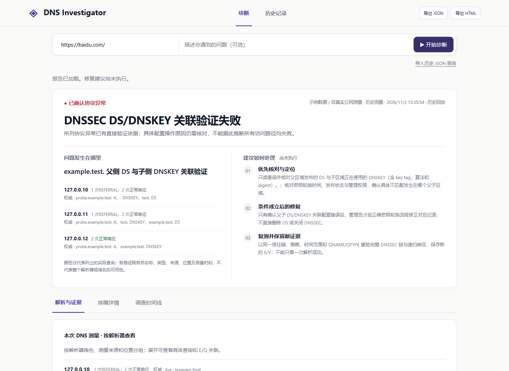
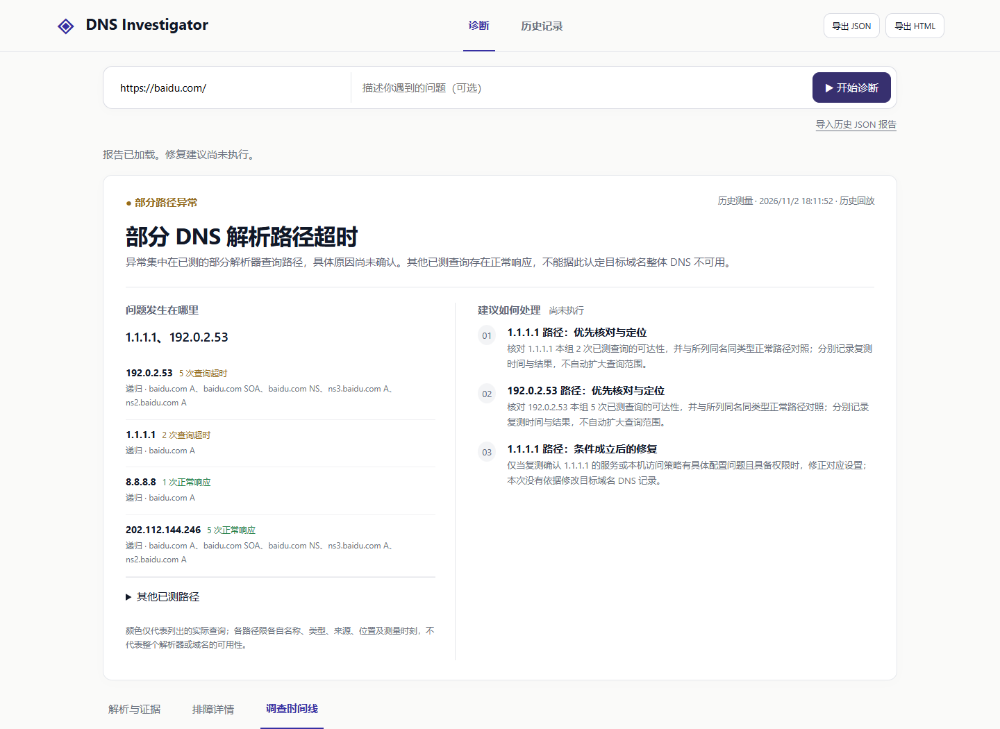

# DNS Investigator

### DNS troubleshooting with traceable measurements

English · [简体中文](README.zh-CN.md)

[](https://github.com/heyunz59/dns-investigator/actions/workflows/tests.yml)

[](LICENSE)

DNS Investigator is an open-source tool for troubleshooting DNS and related connection problems from the command line or a local Web interface. Describe the problem and provide a domain or URL. A DeepSeek-powered agent then chooses the checks to run, from DNS lookups and resolver comparisons to authoritative queries, TCP connections and HTTP requests.

Each check is recorded with its target, time, result and source. The report lets you compare resolver responses, follow DNSSEC verification and connection checks, and decide what to investigate next. It also explains what remains unresolved and suggests further checks.


*A redacted replay of a historical Baidu investigation. The system resolver address has been replaced; results reflect the network conditions at the time.*

**Contents:** [Quick start](#quick-start) · [Web interface](#web-interface) · [Command line](#command-line) · [Capabilities](#capabilities) · [How it works](#how-it-works) · [Reading reports](#reading-an-investigation-report) · [Development](#development-and-testing)

## Capabilities

| Layer | Checks | Reported information |
| --- | --- | --- |
| DNS queries | A, AAAA, CNAME, NS and SOA; Answer/Authority/Additional sections, flags, TTLs and alias chains | Response category, records, actual resolver, timing and transport outcome |
| Recursive comparison | System DNS and configured public resolvers, with independently recorded child queries | RCODE, record presence, address sets, aliases, TTL and latency differences |
| Authoritative DNS | Zone/NS discovery and direct queries to a bounded server selection; AA and SOA checks | Recursive/authoritative differences, selected-server differences and discovery progress |
| Delegation trace | Bounded RD=0 tracing from software-distributed root hints, with bailiwick checks | Delegation progress, address dependencies, aliases and stopping point |
| DNSSEC | DS, DNSKEY, RRSIG and supported denial-proof collection and local verification | Validation status, failure stage, direct proof, dependencies and policy limits |
| TCP / TLS / HTTP | IPv4/IPv6 TCP connections, HTTPS verification, HTTP status, redirects and body-read state | Separate resolution, connection, TLS, response-header and follow-up outcomes |
| Diagnosis and remediation | Structured fault localization, path grouping, candidate analysis and conditional actions | Checks, change prerequisites, verification methods and missing information |

For example, when system DNS works but a public resolver times out, the report shows both results. It distinguishes NXDOMAIN, NODATA, SERVFAIL, REFUSED, incomplete aliases and timeouts so you can decide whether to investigate the resolver, authoritative servers or a later connection stage.

If DNS timeouts and HTTP 503 occur in the same investigation, both appear in the report. The report identifies a main problem when the evidence supports that choice; otherwise, it explains the checks needed for each observation.

## Quick start

### Requirements

- **Python 3.11+**. CI covers Linux with Python 3.11/3.12 and Windows with Python 3.12.
- Git and a modern browser for the Web interface.
- A DeepSeek API key for agent investigations. Requests may incur service charges.
- Permission to access the target and the required network paths.

The current package version is `0.6.0rc1`. Installation below uses the default `main` branch. See [CHANGELOG](CHANGELOG.md) for version history.

### 1. Clone

```bash
git clone https://github.com/heyunz59/dns-investigator.git
cd dns-investigator
python -m venv .venv
```

### 2. Install

Windows PowerShell:

```powershell
.\.venv\Scripts\python.exe -m pip install -e ".[web]"
Copy-Item .env.example .env
```

Linux / macOS:

```bash
.venv/bin/python -m pip install -e ".[web]"
cp .env.example .env
```

The `web` extra installs the local interface dependencies. For CLI-only use, replace `-e ".[web]"` with `-e .`. Run subsequent commands from the repository root, with `python` pointing to this environment:

```powershell
# Windows PowerShell
.\.venv\Scripts\Activate.ps1
```

```bash
# Linux / macOS
source .venv/bin/activate
```

If PowerShell activation is restricted, invoke modules using `.\.venv\Scripts\python.exe -m ...` directly.

### 3. Configure DeepSeek

Open the local `.env` file in a text editor and set your key:

```dotenv
DEEPSEEK_API_KEY=
DEEPSEEK_MODEL=deepseek-flash
DEEPSEEK_BASE_URL=https://api.deepseek.com
```

Thinking mode is disabled by default. Other settings can retain their `.env.example` defaults. Keep credentials local; `.env` is ignored by Git. See [configuration](docs/configuration.md) for resolver selection, budgets and network authorization.

### 4. Start

```bash
python -m dns_investigator.web
```

Open **http://127.0.0.1:8765**. The installed `dns-investigator-web` command starts the same application.

## Web interface

1. Enter a domain or an HTTP(S) URL, including a port, path or query string if relevant.
2. Optionally describe the symptom, such as intermittent system-resolver failures or a DNSSEC validation problem.
3. Start the investigation and follow actual execution progress and recorded tool calls.
4. Review the summary and working/failing paths, then inspect the evidence before choosing an action.

| View | Purpose |
| --- | --- |
| Summary | Primary/parallel observations, fault location, path comparisons and priority actions |
| Resolution & evidence | Queries grouped by resolver, including type, result, RCODE, timing and E/Q/A links |
| Troubleshooting | Full conclusions, certainty levels, branches, prerequisites and verification steps |
| Timeline | Actual calls, parameters, execution state, duration and related evidence |
| History | Filter and reopen saved investigations by target |

You can cancel an investigation while it runs; results already obtained will be saved. Export JSON for further analysis, or an HTML report with embedded styles for offline viewing and printing. Review targets, URLs, resolver addresses and credentials before sharing either format.

The Web service binds to loopback for single-machine use. See [security design](docs/security.md) for its access controls and deployment boundaries.

## Command line

### Single query

```bash
dns-investigator "lookup example.com A records"
```

A lookup returns the requested records, TTLs and query source. To investigate a failure, describe the symptom:

```bash
dns-investigator "Investigate example.com DNS failures and compare recursive resolvers"
dns-investigator "Trace example.com delegation and check DNSSEC validation"
dns-investigator "Investigate why https://example.com/ is inaccessible"
```

These commands call DeepSeek and may make network requests within the configured permissions. The agent uses the results and remaining call allowance to decide whether further checks are needed.

### JSON and detailed output

```bash
dns-investigator "Investigate DNS resolution" --target example.com --format json > investigation.json
dns-investigator "Investigate example.com DNS resolution" --verbose
python -m dns_investigator.main --help
```

`--format json` is noninteractive: stdout contains one JSON object, with progress on stderr. Interactive text mode can ask for a missing target; scripts should provide one explicitly.

| Argument | Behavior |
| --- | --- |
| `question` | Optional positional natural-language question |
| `--target` | Explicit domain or HTTP(S) URL |
| `--format text\|json` | Text or machine-readable output; defaults to `text` |
| `--verbose` | Full text report; cannot be combined with JSON |
| `--fixture PATH` | Controlled measurement inputs; agent mode still uses the model |
| `--tools-only` | Fixed independent tool-check sequence without the model |
| `--save-tools PATH` | Save tools-only measurement evidence |
| `-h`, `--help` | Display command help |

| Exit code | Meaning |
| --- | --- |
| `0` | Local completion requirements met, or independent tool checks ended |
| `3` | Limited investigation with insufficient information |
| `1` | Investigation execution failed |
| `2` | Invalid arguments, target or required configuration |

Logs are stored under `results/runs/`, which Git ignores. If the model cannot finish its summary, the application saves the evidence collected so far and provides a fallback report when possible, with the execution failure noted.

## Try it without an API key

Exercise DNS, TCP and HTTP using the bundled C1 fixture:

```bash
python -m dns_investigator.main --target example.com --tools-only --fixture data/fixtures/C1.json --format json
```

This command uses no model or public network. Measurements have `source_mode=fixture`. The tools-only path has a fixed test sequence; omitting `--fixture` enables real network checks.

To explore example reports in the Web interface:

```bash
python -m scripts.prepare_web_demos
python -m dns_investigator.web
```

Open an example from History. Reports are labeled as example data rather than public measurements. An autonomous agent investigation with a fixture still requires a DeepSeek key.

## How it works



One PydanticAI agent carries out the investigation. It reads the question and tool results, then decides what to do next. An A-record lookup usually needs only a DNS query. A significant difference between recursive answers may call for an authoritative query, while a website access problem may need TCP or HTTP checks.

ToolBackend makes the requests and enforces target permissions, timeouts and call limits. DNSSEC verification runs locally with its own computation limits. The report is built from the recorded measurements and verification results; possible causes proposed by the model are listed separately for review.

### Five registered tools

| Tool | Main parameters | Purpose |
| --- | --- | --- |
| `query_dns` | `domain`, `record_type`, `resolver`, `timeout` | Query an authorized name or an allowed observed alias target |
| `compare_resolvers` | `domain`, `record_type`, `timeout` | Compare the configured recursive resolver paths |
| `query_authoritative` | `domain`, `record_type`, `mode`, `timeout` | `basic` discovery/direct queries, `trace` delegation, `dnssec` supported verification |
| `check_tcp` | `ip`, `port`, `timeout` | Connect to an authorized endpoint supported by target DNS evidence |
| `check_http` | `url`, `timeout` | GET with certificate verification, destination pinning and redirect authorization |

These are agent tool interfaces. Resolver sets, budgets and permissions are local configuration; CLI options are listed above.

### Evidence and provenance

| Prefix | Record | Accounting |
| --- | --- | --- |
| A | Tool-call attempt | Includes parameter refusals, execution errors and repeated calls |
| Q | Actual DNS request attempt | Linked to its parent tool call; a composite call can issue multiple requests |
| E | Measurement | Response or transport observation, with scope and source |
| V | Local verification | E/V dependencies, policy, trust anchor and validation time |

A single tool call can issue several DNS requests. Each request is recorded and counted separately, and call IDs link concurrent results to the right request. When reopening a historical report, the application uses the saved records and investigation context, without treating current machine settings as past measurements.

## Reading an investigation report

The report summary explains what went wrong and how far the investigation has progressed. Use the levels below to interpret the conclusion, then check the measurements it references.

| Diagnostic level | Interpretation |
| --- | --- |
| Confirmed protocol issue | Direct protocol verification supports the finding, such as a trusted DS/DNSKEY mismatch |
| Fault scope localized | An observed timeout, refusal or HTTP error is localized; the operational cause still needs investigation |
| Candidate cause | An explanation supported enough to investigate further |
| No fault observed | The relevant measured scope showed no corresponding anomaly |
| Insufficient evidence | More measurements, execution corrections or supported validation material are required |

Recommendations follow **CHECK → POSSIBLE_FIX → VERIFY**. Each recommendation explains when it applies: first confirm the problem, then have an authorized operator make the relevant change, and finally repeat the check. Configuration changes are left to the user.

### Example: resolver-path timeouts

The repository includes a [redacted historical Baidu investigation](data/regressions/baidu-investigation.json) with six tool attempts, 17 DNS requests and 19 measurements:

| Observation | Report treatment |
| --- | --- |
| Five timeouts through the system resolver path | One path group, retaining every query name and type |
| Two timeouts through `1.1.1.1` | A second path observation |
| Successful checks on other DNS paths and an independent TCP connection | Retained as scoped successful observations |
| HTTP 301 followed by a policy-refused redirect | Both the obtained response and incomplete follow-up remain visible |

The report summarizes this as partial DNS-path timeouts and provides separate checks. Documentation address `192.0.2.53` replaces the original private resolver identity consistently. The sample records its original/transformed hashes and provenance.

<details>
<summary>DNSSEC evidence and investigation timeline</summary>


*Actual replay of controlled signed DNS data, locating parent DS / child DNSKEY association failure.*


*Actual tool-call records from the redacted historical investigation above.*

</details>

## Configuration

Common settings are listed below. See [configuration](docs/configuration.md) for complete formats, limits and authorization examples.

| Setting | Default | Purpose |
| --- | --- | --- |
| `DEEPSEEK_MODEL` | `deepseek-flash` | Investigation model |
| `MODEL_TIMEOUT` | `60` | Per-model request timeout in seconds |
| `MAX_TOOL_CALLS` | `10` | Tool-attempt budget |
| `DNS_RESOLVERS` | `system,1.1.1.1,8.8.8.8` | Recursive resolver set |
| `DNS_QUERY_BUDGET` | `32` | Actual DNS request budget |
| `DNS_TOOL_TIMEOUT` | `20` | Composite DNS operation deadline in seconds |
| `MAX_AUTH_SERVERS` | `2` | Selected-authority limit |

`HTTP_ALLOWED_ORIGINS`, `HTTP_ALLOWED_NETWORKS` and `TCP_ALLOWED_NETWORKS` provide explicit trusted authorization and are empty by default. HTTP uses direct connections; browser proxies and model SDK connectivity can follow different paths.

## Protocol support and safety

- **DNSSEC:** signature algorithms 8/13/14/15, DS digests 2/4 and implemented NSEC/NSEC3 proof scenarios. NSEC3 is limited to zero iterations, empty salt and non-Opt-Out proofs. Unsupported or incomplete validation stays explicitly policy-limited/INDETERMINATE. See the [support matrix](docs/limitations.md).
- **Measurement interpretation:** timeout means no timely response. Address, TTL and SOA differences can arise from caching, updates or traffic steering. Interpret DNS, TCP, TLS and HTTP in their individual target/time/path scope.
- **Network permissions:** investigate authorized targets. HTTP preserves Host/SNI and certificate checks while reauthorizing addresses and redirects; TCP has independent address/port controls.
- **Data handling:** logs remain local by default. Review credentials, private addresses, URLs and model text before sharing; structural checks and automatic redaction do not replace content review.

`completed` means the investigation met the application's output requirements; it does not mean a unique root cause has been confirmed. Independent diagnostic accuracy has not yet been evaluated. See [SECURITY](SECURITY.md), [network security](docs/security.md) and [limitations](docs/limitations.md) for details.

## Development and testing

```bash
python -m pip install -e ".[web,dev]"
python -m pytest -q
python scripts/check_repository.py
```

CI runs the complete suite, dependency checks, wheel builds and installation verification on Linux Python 3.11/3.12 and Windows Python 3.12. The current suite contains 604 cases covering DNS wire behavior, DNSSEC/NSEC3, authorization, concurrency/budgets, agents, reports, Web and CLI. It uses fixed data, scripted models and controlled local services, with no paid API or public target required.

Build and verify a wheel:

```bash
python -m pip wheel --no-deps . --wheel-dir dist
python scripts/check_installation.py --wheel-dir dist --restore-editable --output results/runs/installation.json
```

Before running the installation check, make sure `dist` contains exactly one project wheel. The script tests the CLI command and module entry points, JSON output, Web application and bundled resources from outside the checkout. See [development](docs/development.md) and [evaluation](docs/evaluation.md) for browser checks, historical replay and model experiments.

## Repository layout

```text
dns-investigator/
├── src/dns_investigator/  # Agent, tools, protocols, diagnosis and Web
├── tests/                # Automated tests and fixed regression inputs
├── data/                 # Tool fixtures and redacted historical samples
├── evaluation/           # Controlled services, replay and evaluation programs
├── scripts/              # Installation, resource, repository and browser checks
├── docs/                 # Architecture, configuration, security and guides
└── results/              # Local generated output, excluded from version control
```

## Documentation and contribution

- [Architecture and data flow](docs/architecture.md)
- [Configuration and network authorization](docs/configuration.md)
- [CLI and Web user guide](docs/usage.md)
- [Protocol support and limitations](docs/limitations.md)
- [Development](docs/development.md) · [Evaluation methods](docs/evaluation.md)
- [Changelog](CHANGELOG.md) · [Historical archive](docs/archive/README.md)

To report a bug, open an Issue with reproduction steps and remove sensitive details from any attached logs. Code, test and documentation changes can be submitted as pull requests; see [CONTRIBUTING](CONTRIBUTING.md) for the requirements. Use [GitHub private vulnerability reporting](https://github.com/heyunz59/dns-investigator/security/advisories/new) for security vulnerabilities.

## License

Original project code and documentation are licensed under the [MIT License](LICENSE). Dependencies and bundled IANA/ICANN resources retain their respective rights and provenance; see [third-party notices](THIRD_PARTY_NOTICES.md).
