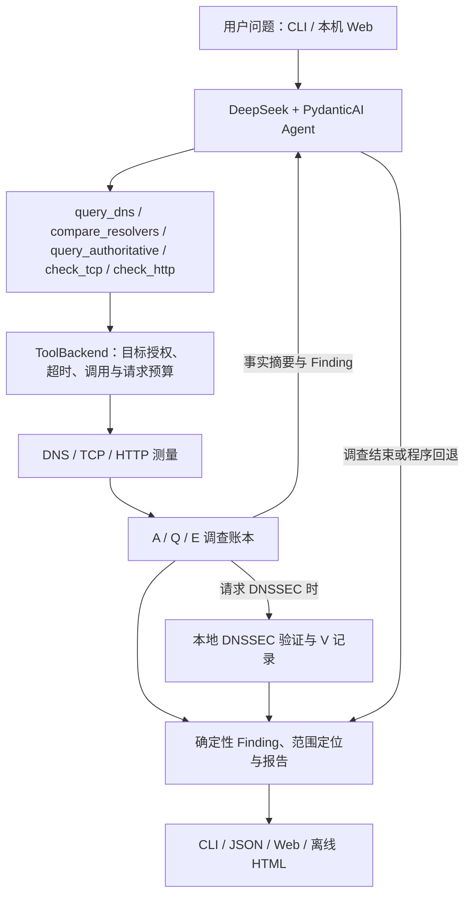

# DNS Investigator

### 基于 AI Agent 与可追溯证据的 DNS 故障调查工具

[English](README.md) · 简体中文

[](https://github.com/heyunz59/dns-investigator/actions/workflows/tests.yml)

[](LICENSE)

DNS Investigator 是一个面向 DNS 排障的开源工具。它使用 DeepSeek 和 PydanticAI 驱动单个调查 Agent，按问题需要选择 DNS、TCP 和 HTTP 检查，将网络测量、协议验证、异常定位与后续排障步骤组织为可追溯的调查报告。

当一个域名解析失败、不同解析器回答不一致，或 DNS 已正常解析但网站仍无法访问时，DNS Investigator 可以帮助你确认失败发生在哪一条已测路径、哪些解释有证据支持，以及下一步应检查什么。可通过命令行使用，也可在本机 Web 界面查看解析器对照、验证依据和调查时间线。


*脱敏历史调查的实际 Web 回放。示例中的系统解析器以文档地址表示，测量结果对应保存时刻。*

**导航：** [快速开始](#快速开始) · [Web 使用](#web-使用) · [命令行](#命令行使用) · [诊断能力](#诊断能力) · [工作原理](#工作原理) · [报告解读](#如何阅读调查报告) · [开发与测试](#开发与测试)

## 诊断能力

| 调查环节 | 主要能力 | 报告内容 |
| --- | --- | --- |
| DNS 查询 | A、AAAA、CNAME、NS、SOA；保存 Answer、Authority、Additional、TTL、标志位和 CNAME 链 | 应答状态、记录、实际解析器、查询时间与传输结果 |
| 递归解析器对照 | 对比系统 DNS 与配置的公共解析器；分别记录每项子查询 | 响应码、记录存在性、地址集合、别名、TTL 与耗时差异 |
| 权威 DNS | 发现相关区域和 NS，有限选择服务器进行直接查询，检查 AA 与 SOA | 递归与权威的差异、选中权威服务器之间的差异及发现过程 |
| 委派追踪 | 基于根服务器快照、RD=0 和 bailiwick 校验进行有界追踪 | 已走过的委派路径、地址依赖、别名路径和停止位置 |
| DNSSEC | 采集 DS、DNSKEY、RRSIG 与否定证明，在支持范围内进行本地验证 | 验证状态、失败阶段、直接依据、依赖材料与策略限制 |
| TCP / TLS / HTTP | IPv4/IPv6 TCP 连接、HTTPS 证书验证、HTTP 状态、重定向与正文读取状态 | 区分解析、连接、TLS、响应头和后续请求的实际结果 |
| 报告与排障 | 结构化异常定位、路径聚合、候选原因、条件式建议 | 检查方向、变更前提、复测方式和缺失信息 |

典型用法包括：

- **定位解析失败范围**：区分 NXDOMAIN、NODATA、SERVFAIL、REFUSED、未完成别名解析及查询超时。
- **比较不同 DNS 路径**：识别“系统 DNS 正常，某个公共解析器超时”等情况，保留正常对照。
- **检查 DNSSEC 阻断环节**：把父侧 DS 与子侧 DNSKEY 不匹配等协议异常定位到相关区域和验证阶段。
- **调查网站访问问题**：在 DNS 证据之外按需检查 TCP、TLS 和 HTTP，分别保留不同连接的结果。
- **分析混合异常**：同时展示 DNS 超时与 HTTP 503 等观测；证据不足以排序时保留并列诊断。

## 快速开始

### 环境要求

- Python **3.11 或更高版本**；CI 覆盖 Linux Python 3.11/3.12 和 Windows Python 3.12。
- Git；使用 Web 界面时需要现代浏览器。
- DeepSeek API Key，用于 Agent 调查。API 调用按服务商规则计费。
- 对调查目标及所需网络访问具有授权。

当前包版本为 `0.6.0rc1`。下列命令从默认 `main` 分支安装；版本变化见 [CHANGELOG](CHANGELOG.md)。

### 1. 获取源码

```bash
git clone https://github.com/heyunz59/dns-investigator.git
cd dns-investigator
python -m venv .venv
```

### 2. 安装

Windows PowerShell：

```powershell
.\.venv\Scripts\python.exe -m pip install -e ".[web]"
Copy-Item .env.example .env
```

Linux / macOS：

```bash
.venv/bin/python -m pip install -e ".[web]"
cp .env.example .env
```

`[web]` 包含本机 Web 所需依赖。仅使用 CLI 时，将安装参数改为 `-e .`。在项目根目录运行后续命令；以下示例中的 `python` 应指向项目虚拟环境：

```powershell
# Windows PowerShell
.\.venv\Scripts\Activate.ps1
```

```bash
# Linux / macOS
source .venv/bin/activate
```

若 PowerShell 禁止执行激活脚本，可直接使用 `.\.venv\Scripts\python.exe -m ...` 运行模块。

### 3. 配置 DeepSeek

用文本编辑器打开本地 `.env`，填写自己的密钥：

```dotenv
DEEPSEEK_API_KEY=
DEEPSEEK_MODEL=deepseek-flash
DEEPSEEK_BASE_URL=https://api.deepseek.com
```

默认关闭模型思考模式。其余配置可保留 `.env.example` 中的默认值。密钥只保存在本机；`.env` 已加入 Git 忽略规则。完整配置及网络授权方式见 [配置指南](docs/configuration.md)。

### 4. 启动

```bash
python -m dns_investigator.web
```

浏览器打开 **http://127.0.0.1:8765**。安装后的 `dns-investigator-web` 命令提供相同入口。

## Web 使用

1. 输入域名或 HTTP/HTTPS URL。URL 可包含端口、路径和查询参数。
2. 按需添加问题描述，例如“系统 DNS 偶尔解析失败，请比较递归路径”或“检查 DNSSEC 验证失败的位置”。
3. 启动调查，查看实际执行进度、已记录的工具调用和当前结果。
4. 从首页查看异常范围、正常路径及优先检查方向，再进入详情核对证据。

| 界面 | 用途 |
| --- | --- |
| 诊断首页 | 主要/并列观测、故障位置、解析路径对照和优先行动 |
| 解析与证据 | 按解析器查看查询名称、类型、结果、RCODE、耗时及 E/Q/A 关联 |
| 排障详情 | 完整结论、确认等级、检查分支、变更前提和验证步骤 |
| 调查时间线 | 实际工具调用、参数、执行状态、耗时和关联证据 |
| 历史记录 | 按目标筛选已保存调查，重新查看报告 |

支持取消正在运行的调查，保留取消前已取得的证据。JSON 导出适合程序处理和复核；HTML 导出自包含样式，可离线打开、打印和分享。分享前应检查目标、URL、解析器和日志中的网络信息。

Web 默认只监听本机回环地址，适用于单机调查。部署边界和访问控制见 [安全说明](docs/security.md)。

## 命令行使用

### 单项查询

```bash
dns-investigator "查询 example.com 的 A 记录"
```

Agent 根据单项查询需求获取记录，报告地址、TTL 和来源。需要调查故障时，直接描述症状：

```bash
dns-investigator "example.com 解析失败，请比较系统 DNS 和公共解析器"
dns-investigator "检查 example.com 的委派链及 DNSSEC 验证情况"
dns-investigator "https://example.com/ 无法访问，请判断故障发生在哪个环节"
```

这些命令调用真实模型，并可能执行真实网络检查。具体工具、次数和后续方向由 Agent 根据证据与预算选择。

### JSON 与详细输出

```bash
dns-investigator "调查 example.com 的 DNS 解析" --target example.com --format json > investigation.json
dns-investigator "调查 example.com 的 DNS 解析" --verbose
python -m dns_investigator.main --help
```

`--format json` 启用非交互输出，stdout 仅包含一个 JSON 对象，进度写入 stderr。交互式 CLI 在缺少目标时会请求补充；脚本调用应显式提供目标。

| 参数 | 行为 |
| --- | --- |
| `question` | 自然语言问题，可作为第一个位置参数 |
| `--target` | 显式指定域名或 HTTP(S) URL |
| `--format text\|json` | 选择文字或机器可读输出，默认 `text` |
| `--verbose` | 展开完整文字报告；与 `--format json` 互斥 |
| `--fixture PATH` | 使用受控测量数据；Agent 模式仍调用模型 |
| `--tools-only` | 按固定顺序运行工具独立验证，跳过模型 |
| `--save-tools PATH` | 保存 tools-only 模式的测量证据 |
| `-h`、`--help` | 查看命令帮助 |

| 退出码 | 含义 |
| --- | --- |
| `0` | 调查满足本地完成要求，或工具独立验证执行结束 |
| `3` | 信息不足的有限调查结果 |
| `1` | 调查执行失败 |
| `2` | 参数、目标或必要配置无效 |

运行日志默认保存在 `results/runs/`，该目录不进入 Git。模型总结失败时仍会保存已有证据及可用的程序回退报告，执行失败状态保持可见。

## 无 API Key 体验

使用仓库自带的 C1 测试数据验证 DNS、TCP、HTTP 工具链：

```bash
python -m dns_investigator.main --target example.com --tools-only --fixture data/fixtures/C1.json --format json
```

这条命令不调用模型，也不访问公网；结果中的 `source_mode` 为 `fixture`。`--tools-only` 使用固定测试流程，去掉 `--fixture` 后会运行真实网络检查。

查看 Web 示例：

```bash
python -m scripts.prepare_web_demos
python -m dns_investigator.web
```

在“历史记录”中打开示例，页面会标注“示例数据 / 非真实公网测量”。使用 fixture 调查并让 Agent 自主选择工具时，仍需配置 DeepSeek 密钥。

## 工作原理



**Agent 负责调查选择。** 它根据用户问题、工具结果和剩余预算决定继续查询、切换路径或结束。单项查询通常只需 DNS；递归响应存在实质差异时可以深入权威路径；访问问题才按需加入 TCP/HTTP。

**程序负责事实与协议判断。** ToolBackend 执行授权、预算、并发归属和错误分类。DNSSEC 验证在隔离且受限的计算流程中运行。报告器依据实际账本生成事实、异常范围和建议，保留模型提供的候选分析供复核。

### 五个工具

| 工具 | 主要参数 | 作用 |
| --- | --- | --- |
| `query_dns` | `domain`、`record_type`、`resolver`、`timeout` | 查询授权名称及已允许跟进的别名目标 |
| `compare_resolvers` | `domain`、`record_type`、`timeout` | 查询配置的递归解析路径并比较结果 |
| `query_authoritative` | `domain`、`record_type`、`mode`、`timeout` | `basic` 权威发现/直查，`trace` 委派追踪，`dnssec` 支持范围内的验证 |
| `check_tcp` | `ip`、`port`、`timeout` | 检查已有 DNS 依据且通过网络授权的端点 |
| `check_http` | `url`、`timeout` | 带证书验证、目标固定与重定向授权的 GET 检查 |

以上是 Agent 的工具接口。解析器集合、预算和网络许可由本地配置管理；CLI 参数见前文。

### 证据与来源

| 编号 | 含义 | 说明 |
| --- | --- | --- |
| A | 工具调用尝试 | 包括参数拒绝、执行错误及重复调用 |
| Q | 实际 DNS 请求尝试 | 关联父工具调用；复合工具可能产生多个 Q |
| E | 测量证据 | 保存响应或超时等实际测量结果及来源 |
| V | 本地验证结果 | 关联 E/V 依赖、策略、信任锚和验证时间 |

复合工具的子查询单独计入 DNS 请求预算。并发调用通过明确调用 ID 关联证据。历史回放从保存的账本和上下文重建展示，不使用当前机器配置补造历史事实。

## 如何阅读调查报告

先看**异常范围和确认等级**，再检查引用的事实，最后根据条件选择行动。

| 诊断等级 | 解读方式 |
| --- | --- |
| 已确认协议异常 | 具备相应的直接协议验证依据，例如受信任上下文中的 DS/DNSKEY 不匹配 |
| 已定位异常范围 | 已观测到超时、连接拒绝或 HTTP 错误等现象，具体运维原因仍需检查 |
| 候选原因 | 现有材料支持进一步调查的解释 |
| 未观察到明确故障 | 本次已测范围未出现相应异常 |
| 证据不足 | 需要补充测量、修正执行问题或处理能力限制 |

排障方案分为 **CHECK（检查）→ POSSIBLE_FIX（条件成立后的修正）→ VERIFY（复测）**。每个分支说明触发条件、解释、下一步以及管理权限等前提，程序不会自动执行配置变更。

### 实际案例：解析路径超时

仓库保留了一份[脱敏后的百度历史调查](data/regressions/baidu-investigation.json)。它包含 6 次工具尝试、17 次 DNS 请求、19 条测量证据：

| 已测结果 | 报告中的处理 |
| --- | --- |
| 一条系统解析路径发生 5 次超时 | 归为一个路径异常组，保留所有查询名称与类型 |
| `1.1.1.1` 路径发生 2 次超时 | 形成另一组观测 |
| 其他 DNS 路径和独立 TCP 检查成功 | 作为相应范围的正常观测保留 |
| HTTP 收到 301，后续跳转被策略拒绝 | 同时展示已收到的响应和未完成的后续检查 |

报告据此归纳为“部分 DNS 解析路径超时”，并分别给出检查方向。示例系统解析器身份已替换为文档地址 `192.0.2.53`；原始与脱敏哈希、来源和转换说明保存在样本中。

<details>
<summary>查看 DNSSEC 验证与调查时间线</summary>


*受控签名 DNS 数据的实际回放：定位父侧 DS 与子侧 DNSKEY 的关联验证失败。*


*上述脱敏历史调查的实际调用记录。*

</details>

## 配置

常用配置如下，完整格式、有效范围和示例见 [配置指南](docs/configuration.md)。

| 配置项 | 默认值 | 用途 |
| --- | --- | --- |
| `DEEPSEEK_MODEL` | `deepseek-flash` | 调查模型 |
| `MODEL_TIMEOUT` | `60` | 单次模型请求超时，秒 |
| `MAX_TOOL_CALLS` | `10` | 工具调用尝试预算 |
| `DNS_RESOLVERS` | `system,1.1.1.1,8.8.8.8` | 递归解析器集合 |
| `DNS_QUERY_BUDGET` | `32` | 实际 DNS 请求预算 |
| `DNS_TOOL_TIMEOUT` | `20` | 复合 DNS 操作总时限，秒 |
| `MAX_AUTH_SERVERS` | `2` | 选中权威服务器数量上限 |

`HTTP_ALLOWED_ORIGINS`、`HTTP_ALLOWED_NETWORKS` 和 `TCP_ALLOWED_NETWORKS` 用于受信任的显式授权，默认留空。HTTP 工具使用直连路径，可能与浏览器代理或模型 SDK 的联网路径不同。

## 支持范围与安全边界

- **DNSSEC**：支持签名算法 8/13/14/15、DS 摘要 2/4，以及已实现的 NSEC 和 NSEC3 证明场景。NSEC3 限零迭代、空 salt、非 Opt-Out；超出支持范围或材料不足时返回明确的能力限制/INDETERMINATE。完整范围见 [支持矩阵](docs/limitations.md)。
- **测量解释**：DNS 超时是未及时取得应答；地址、TTL、SOA Serial 差异可能来自缓存、更新或调度。DNS、TCP、TLS 和 HTTP 结果应按各自目标、时间及路径解读。
- **网络权限**：仅对已授权目标操作。HTTP 保留 Host/SNI 和证书校验，独立检查解析地址及跳转；TCP 有独立地址与端口控制。
- **数据处理**：日志默认留在本机。分享前检查凭证、私有地址、URL 和模型文本；自动脱敏与结构检查不能替代内容审核。

本项目用于辅助调查。`completed` 表示满足本地输出要求，不能作为根因准确率；独立语义准确率尚未建立。详见 [安全政策](SECURITY.md)、[网络安全设计](docs/security.md) 和 [已知限制](docs/limitations.md)。

## 开发与测试

```bash
python -m pip install -e ".[web,dev]"
python -m pytest -q
python scripts/check_repository.py
```

CI 在 Linux Python 3.11/3.12 和 Windows Python 3.12 上运行完整测试、依赖检查、wheel 构建和安装验证。目前自动化套件包含 604 个用例，覆盖 DNS 报文、DNSSEC/NSEC3、网络授权、并发与预算、Agent、报告、Web 和 CLI。测试使用固定样本、脚本模型及本机受控服务，不需要付费 API 或公网目标。

构建并验证安装包：

```bash
python -m pip wheel --no-deps . --wheel-dir dist
python scripts/check_installation.py --wheel-dir dist --restore-editable --output results/runs/installation.json
```

`dist` 中应只有一个项目 wheel。验证会在源码目录外检查两种 CLI 入口、JSON 输出、Web 应用、模块和认证资源。正式浏览器验收、证据重放、同模型评测及开发约定见 [开发指南](docs/development.md) 和 [评测说明](docs/evaluation.md)。

## 项目结构

```text
dns-investigator/
├── src/dns_investigator/  # Agent、工具、协议验证、诊断和 Web
├── tests/                # 自动化测试与固定回归输入
├── data/                 # 工具 fixture 与脱敏历史样本
├── evaluation/           # 受控服务、报告重放与评测程序
├── scripts/              # 安装、资源、仓库及浏览器检查
├── docs/                 # 架构、配置、安全、开发与支持说明
└── results/              # 本机生成结果（不进入版本控制）
```

## 文档与贡献

- [架构与数据流](docs/architecture.md)
- [配置与网络授权](docs/configuration.md)
- [CLI 与 Web 操作指南](docs/usage.md)
- [支持范围与限制](docs/limitations.md)
- [开发与测试](docs/development.md) · [评测方法](docs/evaluation.md)
- [变更记录](CHANGELOG.md) · [历史材料索引](docs/archive/README.md)

欢迎通过 Issue 提交经过脱敏的复现步骤，通过 PR 改进实现、测试和文档。贡献流程见 [CONTRIBUTING.md](CONTRIBUTING.md)。安全问题请使用 [GitHub 私密漏洞报告](https://github.com/heyunz59/dns-investigator/security/advisories/new)，避免公开披露敏感细节。

## 许可证

项目原创代码与文档采用 [MIT License](LICENSE)。依赖和随包分发的 IANA/ICANN 资源保留各自的权利及来源说明，详见 [第三方声明](THIRD_PARTY_NOTICES.md)。
