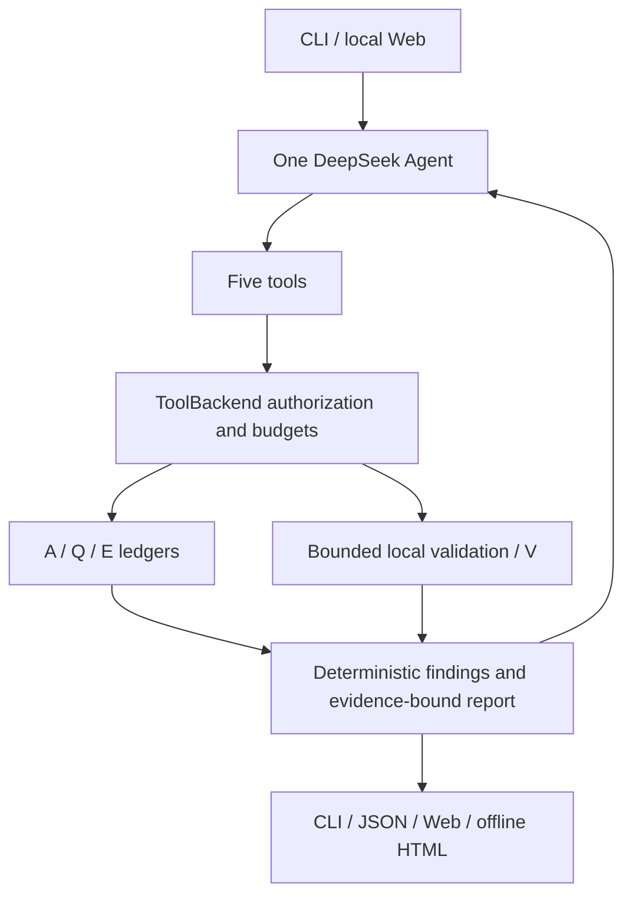

# Architecture

One PydanticAI Agent uses DeepSeek to select five tools dynamically. Single queries do not force a full investigation.

|Tool|Purpose|
|---|---|
|query_dns|A/AAAA/CNAME/NS/SOA, sections/flags, RCODE and transport outcomes|
|compare_resolvers|Configured recursive paths with independently recorded child queries|
|query_authoritative|basic discovery/direct checks; optional bounded trace/dnssec modes|
|check_tcp|Authorized DNS-evidenced endpoint and port|
|check_http|Authorized URL, pinned connection, TLS and bounded response processing|

Trace, DNSSEC, diagnosis and reporting are ordinary modules, not additional tools or Agents. The model cannot change trust anchors, permissions or budgets.

A records all observed tool attempts including refusals. Q records actual DNS requests linked to parent A. E records measurements, including timeouts without DNS responses. V records local validation with E/V dependencies. Child measurements have explicit ownership, never inferred from completion order. Structured output calls are not network tools.

Findings describe observations, not unique causes. DiagnosticConclusion distinguishes confirmed protocol issues, localized scope, candidates, no observed fault and insufficient evidence. Direct proof and prerequisite material are separate. Timeout aggregation requires compatible resolver/mechanism/source/location/time and preserves every query.

RemediationStep contains CHECK, conditional POSSIBLE_FIX and VERIFY branches; there is no repair executor. Web respects formal selection and does not infer causality from coexistence. Legacy replay restores validated stored context, retains original_result, and never probes or authorizes current execution.
