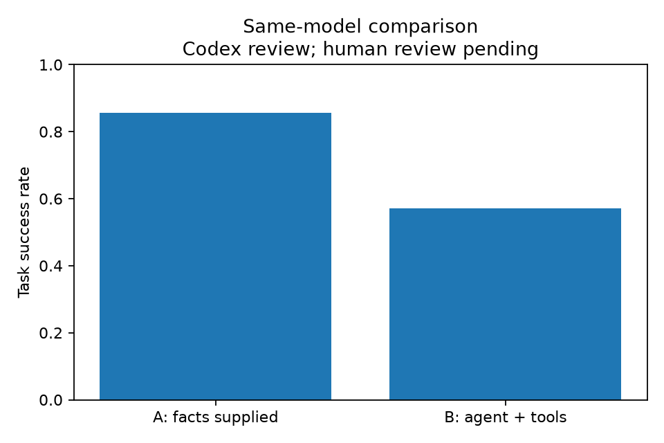

# 实际实验记录与初步评分

2026-10-31，实验 ID `20261031T033230Z`，deepseek-flash，非思考模式，temperature=0，Python 3.12.14 / PydanticAI 2.64.0。应用代码与 520c5c1 提交一致。服务未提供可验证的固定模型权重版本，名称相同不保证未来模型完全不变。

共 7 个场景，每组每场景实际执行 1 次，合计 14 次。A 组提前获得全部原始 fixture 事实；B 组自主按需获取，缺失的 fixture 明确返回工具错误，不回退真实网络。两个组都没有获得标准结论。全部原始回答以运行 ID 命名保存，失败不删除。先前匹配过宽的试运行不纳入本次结果。

| 指标 | A：同模型+已给事实 | B：同模型 Agent+Tools |
|---|---:|---:|
| 任务通过数 / 实际执行数 | 6/7 | 4/7 |
| 初步任务成功率 | 85.7% | 57.1% |
| 合理工具调用数 / 总工具调用数 | N/A（零调用） | 31/46 |
| 初步工具调用正确率 | N/A | 67.4% |
| 平均执行耗时 | 7.08 秒 | 11.38 秒 |

上述评分由 **Codex 规则辅助逐项复核，待独立人工复核**，不是独立人工盲评，也不代表统计显著性。任务评分依据 cases.json 的必需标准，以及禁止虚构未执行测量的通用规则。review.csv 逐例列出原因，call-review.csv 逐调用列出合理性判断。首次合理但无 fixture 的测量不因工具失败自动判错；重复请求同一缺失事实、无依据的下游检查、超出单项 A 查询的调用计不合理。这样的判定有主观性，可修改并重新生成图表。

C3 的 B 组触发 UsageLimitExceeded，证据已保存但无最终结果，任务计 0。Q1 的 B 组额外请求 AAAA，违反只查 A 的标准，计 0。C6c 两组都将不分阶段的 HTTP 超时过度定位为连接/握手异常；A 的假设还写了未经 TCP 测量验证的 TCP 超时，按通用规则严格计 0。独立人工复核可依据原文调整评分，不应删除不理想答案。

本结果不支持宣称 Agent 优于直接 LLM：A 提前知道全量事实；B 承担检索成本，且 fixture 覆盖稀疏，使部分合理请求无事实可取，模型又会重复无效请求。可在扩充原始事实覆盖、改善错误提示与停止策略后开展新实验，但不得覆盖本次结果。fixture 中的文档保留 IP 还可能让模型引入外部先验，是实验设计的局限。

总时间来自实际运行日志，包含模型、工具与框架开销；fixture 工具耗时接近零，不能当真实网络延迟。每案例只做 1 次重复，没有置信区间。比较图来自 evaluation.csv，仅呈现本次初步评分。

