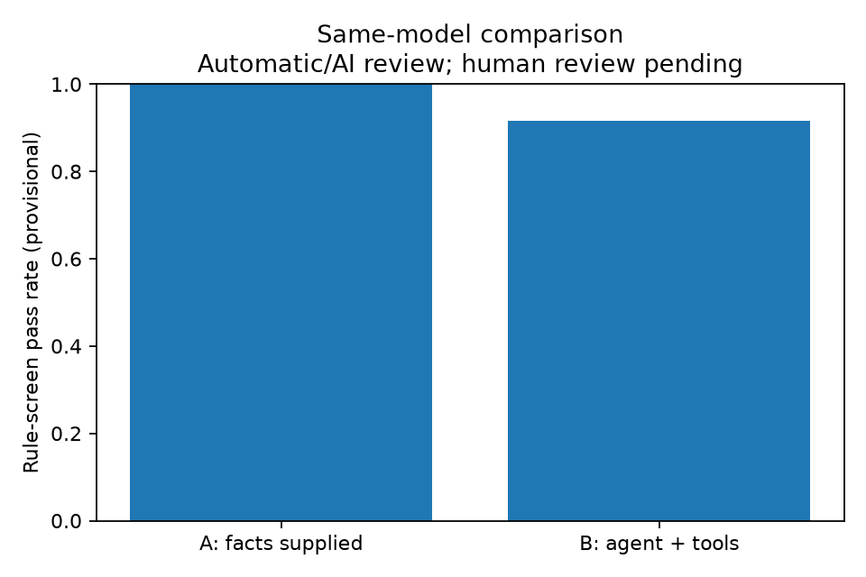

# v0.2 真实同模型对照：规则筛查结果，待人工复核

实验 `20261031T035848Z-c29b66`，2026-10-31。共 8 场景 × 每组 3 次 × A/B 两组，**48 次均实际执行并保留**。deepseek-flash、非思考模式、temperature=0、MODEL_TIMEOUT=60、MAX_TOOL_CALLS=10；未静默切换模型或模式，没有因额度不足而缩减重复数。

源码在实验开始时固定为 d6d67d8，experiment.json 同时保存具体文件 SHA256。后续补充了事件结束通知去重、内部错误重复阻止、CLI 有限结果退出码和评分材料；这些补充的离线回归也单独验证。不能将实验误称为之后所有提交的重新运行。服务未提供可验证的固定模型权重版本。

## 实际结果

| 指标 | A：同模型+提前给定原始事实 | B：同模型 Agent+Tools |
|---|---:|---:|
| 实际执行数 | 24 | 24 |
| 通过自动案例规则筛查 | 24/24 | 22/24 |
| 初步规则筛查通过率 | 100% | 91.7% |
| 自动规则建议合理调用 / 全部网络尝试 | N/A（0 次） | 78/83 |
| 初步工具调用正确率 | N/A | 94.0% |
| 平均整次耗时 | 7.29 秒 | 9.22 秒 |
| completed / limited / failed | 10 / 14 / 0 | 9 / 13 / 2 |

这里的 **success_rate 是机械规则筛查，不是完整语义任务成功率**。规则包括实际返回、证据与必要测量、假设数量、案例关键词和指定调用限制，不能保证模型没有过度解释、错误因果或不合理建议。reviewer 为 automatic_rules_pending_human_review，**没有冒充独立人工评分**。call-review.jsonl 逐尝试提供自动判断与理由；rule-checks.json 保存每条规则结果；review.csv 可以由人工逐项复核后重算。不能将本结果作为 Agent 优于 LLM 的证据。

| 场景 | A 通过 / 3 | B 通过 / 3 | B 全部网络尝试 |
|---|---:|---:|---:|
| C1 正常、未复现 | 3 | 3 | 12 |
| C2 NXDOMAIN | 3 | 2 | 14 |
| C3 默认解析器超时、备用成功 | 3 | 3 | 12 |
| C4 TCP 超时 | 3 | 3 | 12 |
| C5 HTTP 503 | 3 | 3 | 12 |
| C6c HTTP 超时、保留有限结论 | 3 | 3 | 12 |
| Q1 只查询 A | 3 | 3 | 3 |
| MISSING 专门缺失 AAAA 数据 | 3 | 2 | 6 |

limited 是合法的信息不足结果；它可以满足“承认本次未复现、保留已知与未知”这类案例标准，但不能当作确认唯一故障原因。程序的 requirements_met 仅表示 answered 的本地结构门槛，与本表的案例规则通过含义不同。

## 两次真实失败及保留记录

- MISSING 第 2 次 B：`2f4731d9389f4c058c71ceea3f2c9422.json`。A 查询成功；AAAA 返回明确 FIXTURE_NOT_COVERED，未进行重试或 live 回退。但模型反复将调用尝试 A2 填入 evidence_id，输出校验拒绝接受，最终 UnexpectedModelBehavior。程序保留 2 次尝试和 1 条测量，返回 application_fallback / execution_failed，不伪造模型结论。
- C2 第 3 次 B：`8e306400f75a40ca9b819358183a1a1b.json`。保留 5 次调用尝试，其中一次参数拒绝；模型将该尝试 A4 当作测量证据引用，重试后仍未修正，最终失败。失败调用也进入 83 次总分母。

C3 的 3 次 B 均取得模型结果（1 completed、2 limited），未再出现旧实验的 UsageLimitExceeded。Q1 的 3 次 B 均只查询 A。MISSING 的 3 次 B 均没有重复执行不可重试的缺失事实请求；其中一次仍因最终引用错误失败。这说明错误反馈和停止行为改善不等于全部结论均已可靠。

## 解释边界

A 提前知道全量 fixture 原始事实，B 按需获取；实际信息集合可不同。fixture 覆盖和评分方式都已调整，旧版工具尝试还统计不全，**不能把旧版 67.4% 与新版 94.0% 直接当作同口径提升**。应人工复核新表，并在固定数据、固定评分口径下做进一步比较。

每场景仅 3 次重复，未估计置信区间；fixture 的工具耗时不代表真实网络延迟。文档保留地址可能触发模型外部先验。结构校验不保证“两个合理假设”的全部语义，引用合法也不证明解释正确。所有失败原文均保留，未预设 Agent 一定更好。

